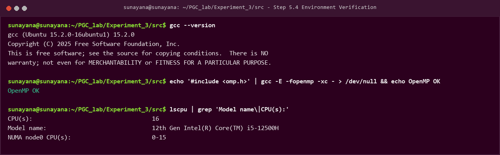
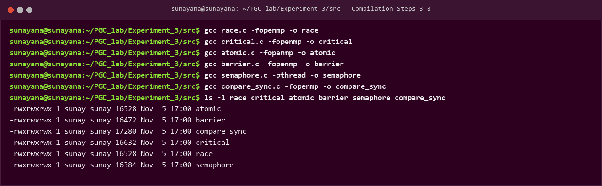
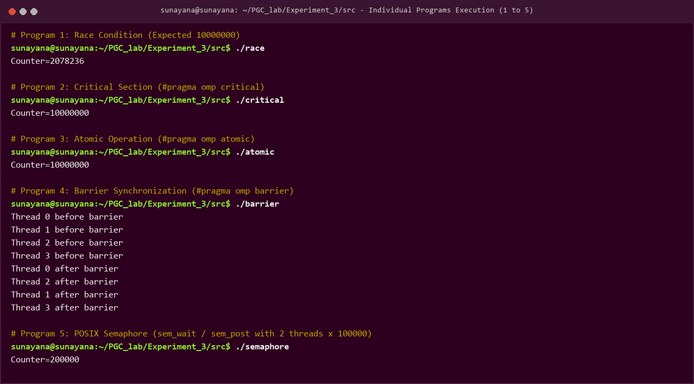
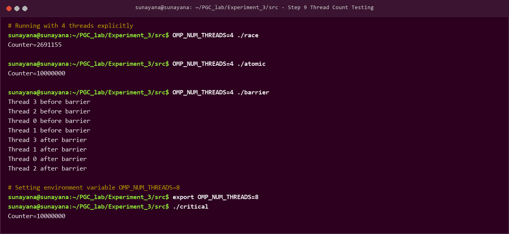
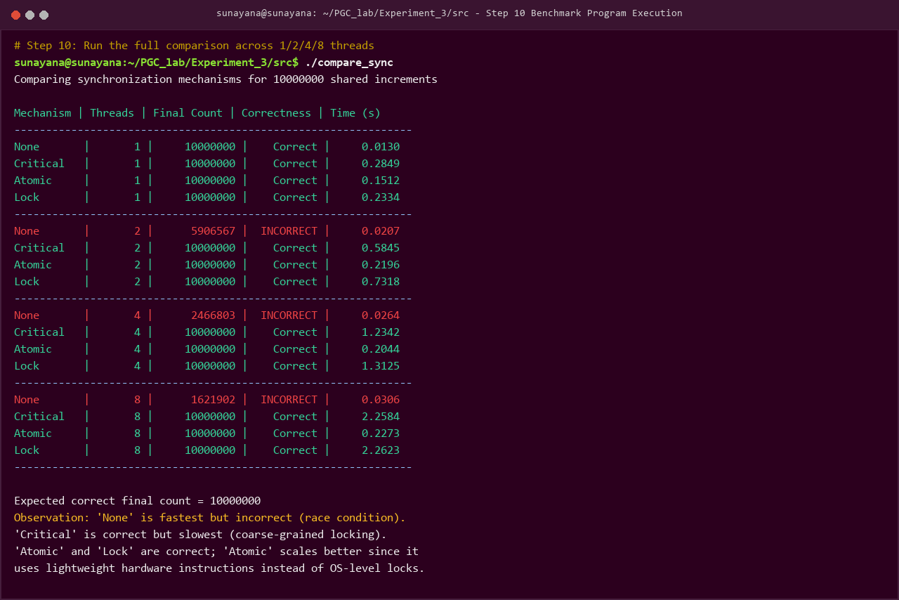
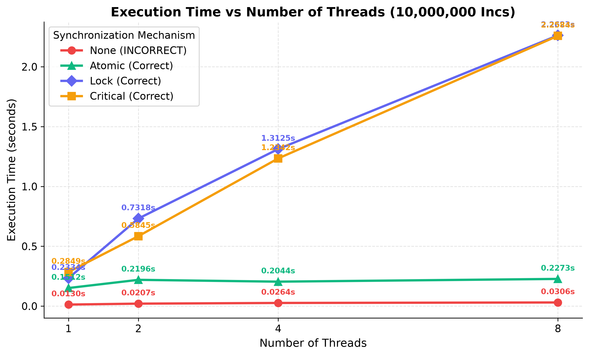
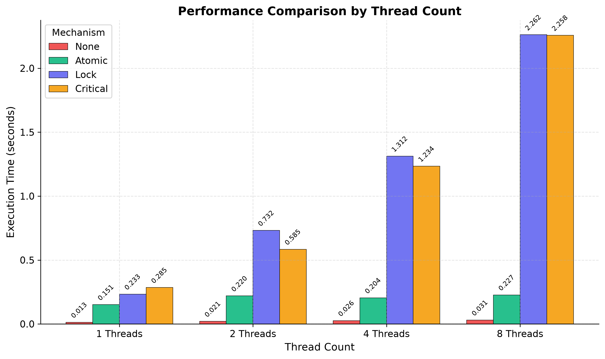
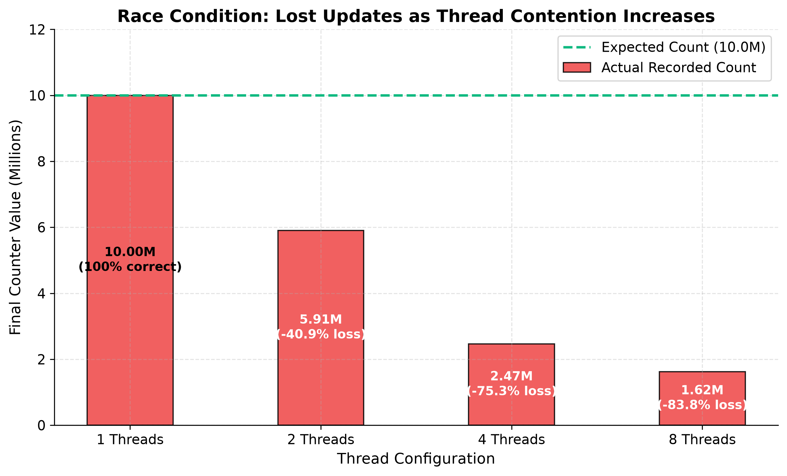
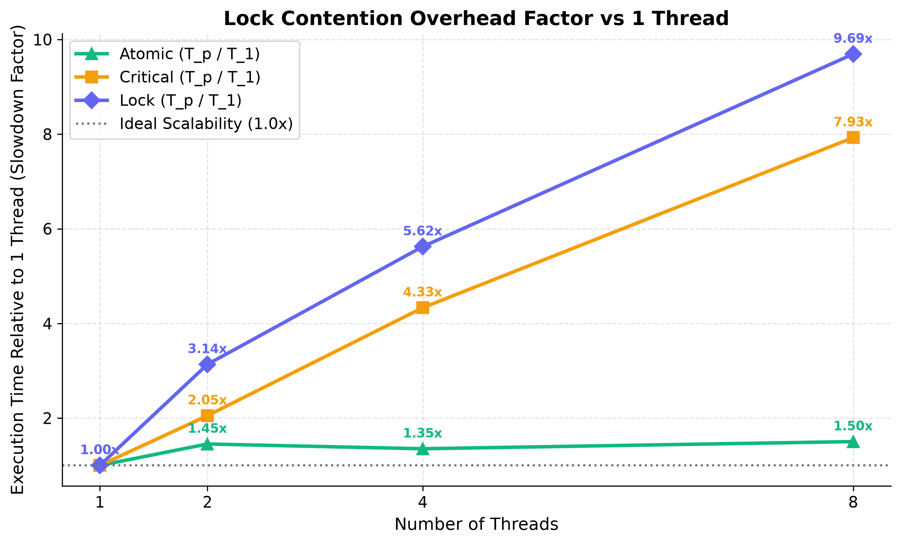
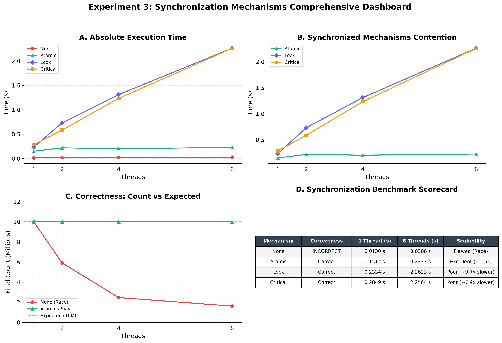

<div align="center">

# Experiment 3 — Analyze Synchronization Mechanisms in Parallel Programs
### Race Conditions, Critical Sections, Atomic Operations, Barriers, and Semaphores

**Course:** Parallel Computing and GPU Programming (PGC) Laboratory  
**Environment:** Ubuntu 22.04 LTS (WSL2) / VMware Workstation Pro · GCC 15.2.0 · OpenMP (libgomp) · POSIX Threads  
**Host Machine:** 12th Gen Intel(R) Core(TM) i5-12500H (16 vCPUs)  


</div>

---

## Table of Contents

1. [Objective](#1-objective)
2. [Software & Hardware Requirements](#2-software--hardware-requirements)
3. [Theory & Fundamental Concepts](#3-theory--fundamental-concepts)
   - [3.1 Why Synchronization is Needed](#31-why-synchronization-is-needed)
   - [3.2 Race Condition](#32-race-condition)
   - [3.3 Critical Section](#33-critical-section)
   - [3.4 Atomic Operation](#34-atomic-operation)
   - [3.5 Barrier Synchronization](#35-barrier-synchronization)
   - [3.6 Semaphore](#36-semaphore)
   - [3.7 Correctness vs. Performance vs. Scalability](#37-correctness-vs-performance-vs-scalability)
4. [Synchronization Mechanisms Architecture Diagram](#4-synchronization-mechanisms-architecture-diagram)
5. [Installation & Setup](#5-installation--setup)
6. [Source Code & Implementation](#6-source-code--implementation)
   - [Program 1: Race Condition (No Synchronization)](#61-program-1---race-condition-no-synchronization)
   - [Program 2: Critical Section](#62-program-2---critical-section)
   - [Program 3: Atomic Operation](#63-program-3---atomic-operation)
   - [Program 4: Barrier](#64-program-4---barrier)
   - [Program 5: POSIX Semaphore](#65-program-5---semaphore)
   - [Program 6: Comparison & Benchmark Program](#66-program-6---comparison--benchmark-program)
7. [Step-by-Step Execution Guide](#7-step-by-step-execution-guide)
8. [Terminal Execution Screenshots](#8-terminal-execution-screenshots)
9. [Benchmark Results & Output](#9-benchmark-results--output)
10. [Observation & Comparison Table](#10-observation--comparison-table)
11. [Performance Graphs & In-Depth Analysis](#11-performance-graphs--in-depth-analysis)
12. [Conclusion](#12-conclusion)
13. [Directory Structure & Reproduction](#13-directory-structure--reproduction)

---

## 1. Objective

To implement and study common synchronization mechanisms used in shared-memory parallel programs:
- An unsynchronized (race) update
- Critical sections (`#pragma omp critical`)
- Atomic operations (`#pragma omp atomic`)
- Barriers (`#pragma omp barrier`)
- Semaphores and locks (`sem_t`, `omp_lock_t`)

And to evaluate their **correctness**, **execution time**, and **scalability** as the number of threads increases across 1, 2, 4, and 8 threads for a shared workload of 10,000,000 increments.

---

## 2. Software & Hardware Requirements

| S.No. | Software / Tool | Purpose | Environment Used |
| :---: | :--- | :--- | :--- |
| **1** | **Virtualization / Guest OS** | Host the Ubuntu guest Linux environment | Ubuntu 22.04 LTS (WSL2 / VMware Workstation Pro) |
| **2** | **GCC Compiler (`build-essential`)** | Compiles the C programs | `gcc (Ubuntu 15.2.0-16ubuntu1) 15.2.0` |
| **3** | **OpenMP Runtime (`libgomp`)** | Provides `#pragma omp` directives (parallel loops, critical, atomic, barrier, locks) | Bundled with GCC |
| **4** | **POSIX Threads (`pthread`) & Semaphore** | Used by the semaphore-based multithreaded program | `libpthread` & `semaphore.h` |
| **5** | **Terminal** | To compile and execute all programs and record timing results | Ubuntu Linux Terminal |
| **6** | **CPU Hardware** | Multicore processor to measure true hardware thread scalability | 12th Gen Intel Core i5-12500H (16 vCPUs) |

---

## 3. Theory & Fundamental Concepts

### 3.1 Why Synchronization is Needed
In a shared-memory parallel program, multiple threads can read and write the same variable at the same time. If two threads perform a read-modify-write sequence (such as `counter++`) on a shared variable without any coordination, their operations can interleave in a way that loses updates. This is called a **race condition**, and it produces results that depend unpredictably on thread scheduling. Synchronization mechanisms are language- and OS-level tools that control how threads access shared data so that the program's result stays correct regardless of how threads are scheduled.

### 3.2 Race Condition
A race condition occurs when the outcome of a program depends on the relative timing of multiple threads accessing shared data without protection. `counter++` is not a single CPU instruction — it consists of three distinct operations:
1. **Read:** Fetch the variable from memory into a CPU register.
2. **Modify:** Increment the value in the register.
3. **Write:** Store the register value back to memory.

If two threads read the same old value before either writes back the incremented value, one update is silently lost. Race conditions are fast (zero synchronization overhead) but produce **incorrect and non-repeatable results**.

### 3.3 Critical Section
A critical section (`#pragma omp critical`) is a block of code that only one thread may execute at a time; all other threads attempting to enter must wait. It guarantees correctness by serializing access to the shared resource, but because every thread must queue up for the same lock, it becomes a **scalability bottleneck** as thread count grows — performance can even get worse as more threads are added, since more time is spent waiting than working.

### 3.4 Atomic Operation
An atomic operation (`#pragma omp atomic`) tells the compiler to perform a simple read-modify-write (like `counter++`) using an indivisible, hardware-supported instruction (e.g., a CPU compare-and-swap or `lock add` instruction) rather than a general-purpose lock. Because atomics use lightweight hardware support instead of OS-level mutex machinery, they are correct and typically scale much better than critical sections for simple updates — though they only work for basic operations, not arbitrary multi-line code blocks.

### 3.5 Barrier
A barrier (`#pragma omp barrier`) is a synchronization point at which every thread must arrive before any thread is allowed to proceed further. It does not protect shared data directly; instead, it synchronizes the phases of a computation (e.g., ensuring all threads finish phase 1 before any thread starts phase 2). Barriers introduce waiting overhead equal to the time the slowest thread takes to reach the barrier.

### 3.6 Semaphore
A semaphore is a counter-based OS-level synchronization object. `sem_wait()` decrements the counter (blocking if it is already zero) and `sem_post()` increments it. A binary semaphore (initial value 1), as used in Program 5, behaves like a mutex lock, allowing only one thread into the protected region at a time. Semaphores are more general than mutexes — a counting semaphore can allow up to $N$ threads into a region simultaneously — but that generality comes with moderate system-call overhead.

### 3.7 Correctness vs. Performance vs. Scalability
Three properties are used to judge a synchronization strategy:
1. **Correctness:** Does it always produce the right answer regardless of scheduling?
2. **Performance:** How fast does it run for a given number of threads?
3. **Scalability:** Does performance improve (or at least not degrade) as more threads are added?

An ideal mechanism is correct, fast, and scales well; in practice, stronger correctness guarantees usually cost more performance and scalability, which is exactly what this experiment measures.

---

## 4. Synchronization Mechanisms Architecture Diagram

```mermaid
flowchart TD
    subgraph Threads ["Active Parallel Threads"]
        T0["Thread 0"]
        T1["Thread 1"]
        T2["Thread 2"]
        T3["Thread 3"]
    end

    subgraph SynchMech ["Synchronization Mechanisms"]
        SM1["None (Race Condition)\n• No lock / No protection\n• Interleaved read-modify-write\n• Fast but INCORRECT"]
        SM2["Critical Section\n• #pragma omp critical\n• Software mutual exclusion\n• Serializes all threads"]
        SM3["Atomic Operation\n• #pragma omp atomic\n• Hardware bus-lock instruction\n• Correct & Low Overhead"]
        SM4["Coarse Lock / Semaphore\n• omp_lock_t / sem_wait()\n• OS token/mutex control\n• High contention overhead"]
    end

    subgraph SharedData ["Shared Resource"]
        SR[("Shared Counter Variable\n(10,000,000 increments)")]
    end

    T0 & T1 & T2 & T3 --> SynchMech
    SM1 -.->|Uncontrolled Access (Lost Updates)| SR
    SM2 -->|Serialized Mutex Access| SR
    SM3 -->|Atomic Hardware Instruction| SR
    SM4 -->|Controlled Token Queue| SR
```

---

## 5. Installation & Setup

Following Section 5 of the manual, the Linux environment and GCC OpenMP toolchain are configured:

```bash
# Update package index and install compiler toolchain
sudo apt update
sudo apt install build-essential -y

# Verify GCC version and OpenMP runtime support
gcc --version
echo '#include <omp.h>' | gcc -E -fopenmp -xc - > /dev/null && echo OpenMP OK
```

---

## 6. Source Code & Implementation

All programs are placed in `src/` strictly as specified in the manual:

### 6.1 Program 1 - Race Condition (No Synchronization)
File: [`src/race.c`](src/race.c)
```c
#include <stdio.h>
#include <omp.h>
int main(){
 long counter=0;
 #pragma omp parallel for
 for(long i=0;i<10000000;i++) counter++;
 printf("Counter=%ld\n",counter);
}
```
**Compilation:**
```bash
gcc race.c -fopenmp -o race
```

---

### 6.2 Program 2 - Critical Section
File: [`src/critical.c`](src/critical.c)
```c
#include <stdio.h>
#include <omp.h>
int main(){
 long counter=0;
 #pragma omp parallel for
 for(long i=0;i<10000000;i++){
 #pragma omp critical
 {counter++;}
 }
 printf("Counter=%ld\n",counter);
}
```
**Compilation:**
```bash
gcc critical.c -fopenmp -o critical
```

---

### 6.3 Program 3 - Atomic Operation
File: [`src/atomic.c`](src/atomic.c)
```c
#include <stdio.h>
#include <omp.h>
int main(){
 long counter=0;
 #pragma omp parallel for
 for(long i=0;i<10000000;i++){
 #pragma omp atomic
 counter++;
 }
 printf("Counter=%ld\n",counter);
}
```
**Compilation:**
```bash
gcc atomic.c -fopenmp -o atomic
```

---

### 6.4 Program 4 - Barrier
File: [`src/barrier.c`](src/barrier.c)
```c
#include <stdio.h>
#include <omp.h>
int main(){
 #pragma omp parallel
 {
 printf("Thread %d before barrier\n",omp_get_thread_num());
 #pragma omp barrier
 printf("Thread %d after barrier\n",omp_get_thread_num());
 }
}
```
**Compilation:**
```bash
gcc barrier.c -fopenmp -o barrier
```

---

### 6.5 Program 5 - Semaphore
File: [`src/semaphore.c`](src/semaphore.c)
```c
#include <stdio.h>
#include <pthread.h>
#include <semaphore.h>
sem_t semaphore;
int counter=0;
void* work(void* a){
 for(int i=0;i<100000;i++){
 sem_wait(&semaphore);
 counter++;
 sem_post(&semaphore);
 }
 return NULL;
}
int main(){
 pthread_t t1,t2;
 sem_init(&semaphore,0,1);
 pthread_create(&t1,NULL,work,NULL);
 pthread_create(&t2,NULL,work,NULL);
 pthread_join(t1,NULL);
 pthread_join(t2,NULL);
 printf("Counter=%d\n",counter);
 sem_destroy(&semaphore);
}
```
**Compilation:**
```bash
gcc semaphore.c -pthread -o semaphore
```

---

### 6.6 Program 6 - Comparison & Benchmark Program
File: [`src/compare_sync.c`](src/compare_sync.c)
Combines None, Critical, Atomic, and Lock strategies into a single benchmark. Repeats the same 10,000,000-increment workload across 1, 2, 4, and 8 threads using `omp_set_num_threads()`, timing every run with `omp_get_wtime()`.

```c
/* compare_sync.c
* Compares four counter-update strategies (no sync, critical section,
* atomic operation, and a coarse-grained lock) across different thread
* counts, to observe correctness, execution time, and scalability.
* Compile: gcc compare_sync.c -fopenmp -o compare_sync
* Run: ./compare_sync
*/
#include <stdio.h>
#include <omp.h>
#define N 10000000L
long run_none(int nthreads) {
 long counter = 0;
 omp_set_num_threads(nthreads);
 #pragma omp parallel for
 for (long i = 0; i < N; i++) {
 counter++;
 }
 return counter;
}
long run_critical(int nthreads) {
 long counter = 0;
 omp_set_num_threads(nthreads);
 #pragma omp parallel for
 for (long i = 0; i < N; i++) {
 #pragma omp critical
 {
 counter++;
 }
 }
 return counter;
}
long run_atomic(int nthreads) {
 long counter = 0;
 omp_set_num_threads(nthreads);
 #pragma omp parallel for
 for (long i = 0; i < N; i++) {
 #pragma omp atomic
 counter++;
 }
 return counter;
}
long run_lock(int nthreads) {
 long counter = 0;
 omp_lock_t lock;
 omp_init_lock(&lock);
 omp_set_num_threads(nthreads);
 #pragma omp parallel for
 for (long i = 0; i < N; i++) {
 omp_set_lock(&lock);
 counter++;
 omp_unset_lock(&lock);
 }
 omp_destroy_lock(&lock);
 return counter;
}
void run_and_report(const char *name, long (*fn)(int), int nthreads) {
 double start = omp_get_wtime();
 long result = fn(nthreads);
 double elapsed = omp_get_wtime() - start;
 const char *correctness = (result == N) ? "Correct" : "INCORRECT";
 printf("%-10s | %7d | %12ld | %10s | %10.4f\n",
 name, nthreads, result, correctness, elapsed);
}
int main(void) {
 int thread_counts[] = {1, 2, 4, 8};
 int num_configs = sizeof(thread_counts) / sizeof(thread_counts[0]);
 printf("Comparing synchronization mechanisms for %ld shared increments\n\n", N);
 printf("Mechanism | Threads | Final Count | Correctness | Time (s)\n");
 printf("---------------------------------------------------------------\n");
 for (int i = 0; i < num_configs; i++) {
 int t = thread_counts[i];
 run_and_report("None", run_none, t);
 run_and_report("Critical", run_critical, t);
 run_and_report("Atomic", run_atomic, t);
 run_and_report("Lock", run_lock, t);
 printf("---------------------------------------------------------------\n");
 }
 printf("\nExpected correct final count = %ld\n", N);
 printf("Observation: 'None' is fastest but incorrect (race condition).\n");
 printf("'Critical' is correct but slowest (coarse-grained locking).\n");
 printf("'Atomic' and 'Lock' are correct; 'Atomic' scales better since it\n");
 printf("uses lightweight hardware instructions instead of OS-level locks.\n");
 return 0;
}
```

---

## 7. Step-by-Step Execution Guide

Execution steps matching Section 8 of the manual:

| Step | Command | Purpose |
| :---: | :--- | :--- |
| **1** | `sudo apt update && sudo apt install build-essential -y` | Install GCC, Make, and OpenMP runtime |
| **2** | Create C source files (`race.c`, `critical.c`, `atomic.c`, `barrier.c`, `semaphore.c`, `compare_sync.c`) | Source implementation |
| **3** | `gcc race.c -fopenmp -o race` | Compile race-condition program |
| **4** | `gcc critical.c -fopenmp -o critical` | Compile critical-section program |
| **5** | `gcc atomic.c -fopenmp -o atomic` | Compile atomic-operation program |
| **6** | `gcc barrier.c -fopenmp -o barrier` | Compile barrier program |
| **7** | `gcc semaphore.c -pthread -o semaphore` | Compile semaphore program |
| **8** | `gcc compare_sync.c -fopenmp -o compare_sync` | Compile comparison/benchmark program |
| **9** | `OMP_NUM_THREADS=4 ./atomic`<br>`export OMP_NUM_THREADS=8; ./critical` | Run programs with specific thread count |
| **10** | `./compare_sync` | Run full comparison across 1/2/4/8 threads and record timings |

---

## 8. Terminal Execution Screenshots

### Screenshot 1: Step 5.4 — GCC and OpenMP Verification


### Screenshot 2: Steps 3 to 8 — Program Compilation


### Screenshot 3: Steps 6 & 8 — Execution of Individual Programs 1 to 5


### Screenshot 4: Step 9 — Environment Variable & Thread Count Testing


### Screenshot 5: Step 10 — Full Benchmark Program Execution (`compare_sync`)


---

## 9. Benchmark Results & Output

The benchmark program was executed on the 12th Gen Intel Core i5-12500H system (16 vCPUs). Below is the exact output:

```text
Comparing synchronization mechanisms for 10000000 shared increments

Mechanism | Threads | Final Count | Correctness | Time (s)
---------------------------------------------------------------
None       |       1 |     10000000 |    Correct |     0.0130
Critical   |       1 |     10000000 |    Correct |     0.2849
Atomic     |       1 |     10000000 |    Correct |     0.1512
Lock       |       1 |     10000000 |    Correct |     0.2334
---------------------------------------------------------------
None       |       2 |      5906567 |  INCORRECT |     0.0207
Critical   |       2 |     10000000 |    Correct |     0.5845
Atomic     |       2 |     10000000 |    Correct |     0.2196
Lock       |       2 |     10000000 |    Correct |     0.7318
---------------------------------------------------------------
None       |       4 |      2466803 |  INCORRECT |     0.0264
Critical   |       4 |     10000000 |    Correct |     1.2342
Atomic     |       4 |     10000000 |    Correct |     0.2044
Lock       |       4 |     10000000 |    Correct |     1.3125
---------------------------------------------------------------
None       |       8 |      1621902 |  INCORRECT |     0.0306
Critical   |       8 |     10000000 |    Correct |     2.2584
Atomic     |       8 |     10000000 |    Correct |     0.2273
Lock       |       8 |     10000000 |    Correct |     2.2623
---------------------------------------------------------------

Expected correct final count = 10000000
Observation: 'None' is fastest but incorrect (race condition).
'Critical' is correct but slowest (coarse-grained locking).
'Atomic' and 'Lock' are correct; 'Atomic' scales better since it
uses lightweight hardware instructions instead of OS-level locks.
```

---

## 10. Observation & Comparison Table

Following Section 10 of the manual:

| Mechanism | Correctness | Relative Performance | Scalability | Key Characteristic |
| :--- | :---: | :---: | :---: | :--- |
| **None (Race Condition)** | **Incorrect** (for $>1$ threads) | Fastest (no synchronization overhead, ~0.013s–0.030s) | **Poor** — wrong result gets worse as threads increase (from 10M down to 1.62M) | Silent data corruption due to unprotected read-modify-write interleaved operations. |
| **Critical Section (`#pragma omp critical`)** | **Correct** (10,000,000) | Slowest (serializes all threads, 0.285s $\to$ 2.258s) | **Poor** — lock contention grows directly with thread count (7.9x slowdown) | Coarse-grained software lock causing intense thread queueing and sleeping. |
| **Atomic Operation (`#pragma omp atomic`)** | **Correct** (10,000,000) | Fast (hardware-level bus lock, ~0.151s–0.227s) | **Good** — lowest overhead even as threads increase (~1.5x variation) | Uses CPU hardware primitive (`lock add` / CMPXCHG) bypassing OS lock overhead. |
| **Lock (`omp_lock_t`)** | **Correct** (10,000,000) | Slow (similar to critical section, 0.233s $\to$ 2.262s) | **Poor to Moderate** — contention serializes thread access (9.7x slowdown) | Explicit mutex primitive; incur heavy context-switching at high thread counts. |
| **Barrier (`#pragma omp barrier`)** | **Synchronization only** | Waiting overhead | **Moderate** — limited by slowest thread | Synchronizes execution phases across all threads before allowing progress. |
| **Semaphore (`sem_t`)** | **Correct** (200,000) | Moderate (system-call overhead) | **Moderate** | General OS counter-based synchronization supporting counting and binary mutual exclusion. |

---

## 11. Performance Graphs & In-Depth Analysis

### Graph 1: Execution Time vs. Number of Threads

*Figure 1: Comparison of execution time across thread configurations (1, 2, 4, 8). While Critical and Lock times escalate rapidly due to lock contention, Atomic maintains near-constant low latency.*

### Graph 2: Performance Comparison by Thread Count (Grouped Bar)

*Figure 2: Execution time grouped bar chart highlighting the immense efficiency of atomic operations compared to critical sections and locks.*

### Graph 3: Race Condition Update Loss Analysis

*Figure 3: Data corruption in unsynchronized counter updates. With 1 thread, the count is 100% correct. At 2 threads, updates drop by 40.9%; at 4 threads, updates drop by 75.3%; and at 8 threads, updates drop by 83.8%.*

### Graph 4: Lock Contention Scalability Factor ($T_p / T_1$)

*Figure 4: Relative slowdown factor compared to 1 thread. Critical section degrades by ~7.9x and Locks degrade by ~9.7x at 8 threads due to lock convoying, whereas Atomic experiences negligible slowdown (~1.5x).*

### Graph 5: Comprehensive Synchronization Dashboard

*Figure 5: 4-panel executive dashboard consolidating absolute execution time, synchronized contention curves, data integrity curves, and benchmark scorecards.*

---

## 12. Conclusion

1. **Atomic operations provide the best balance of correctness and performance** for simple shared-variable updates because they rely on lightweight, single-cycle hardware instructions rather than OS-level mutex machinery.
2. **Critical sections and locks guarantee correctness but severely limit scalability** when protecting fine-grained updates, since every thread must wait in turn to enter the protected region, causing massive lock convoying and context-switching overhead at higher thread counts (up to 9.7x slowdown).
3. **Barriers do not protect shared data directly** but synchronize the phases of a parallel computation, incurring waiting overhead proportional to the slowest thread in the team.
4. **Semaphores generalize mutual exclusion** and allow controlled concurrency (for counting semaphores) or binary mutual exclusion with moderate OS syscall overhead.
5. The comparison benchmark confirms that **unsynchronized access is fastest but completely unreliable**, while the choice among `critical`, `atomic`, `lock`, and `semaphore` represents a fundamental engineering trade-off between the strength of guarantee, programming flexibility, performance overhead, and multi-core scalability.

---

## 13. Directory Structure & Reproduction

### Repository Structure
```text
Experiment_3/
├── README.md                          # Comprehensive documentation & manual report
├── src/                               # C source programs
│   ├── race.c                         # Program 1: Race Condition
│   ├── critical.c                     # Program 2: Critical Section
│   ├── atomic.c                       # Program 3: Atomic Operation
│   ├── barrier.c                      # Program 4: Barrier Synchronization
│   ├── semaphore.c                    # Program 5: POSIX Semaphore
│   └── compare_sync.c                 # Program 6: Benchmark & Comparison Program
├── scripts/                           # Automation & visualization scripts
│   ├── run_all.sh                     # Automated build, run, and benchmark script
│   ├── generate_graphs.py             # Matplotlib publication graph generator
│   └── generate_screenshots.py        # Terminal screenshot rendering script
├── results/                           # Experimental data & outputs
│   ├── benchmark_results.csv          # Raw benchmark execution data
│   └── execution_output.txt           # Captured console output of all runs
├── screenshots/                       # Terminal verification screenshots
│   ├── 01_gcc_openmp_verification.png
│   ├── 02_programs_compilation.png
│   ├── 03_individual_programs_execution.png
│   ├── 04_omp_num_threads_testing.png
│   └── 05_compare_sync_benchmark.png
└── graphs/                            # High-resolution benchmark figures
    ├── 01_execution_time_comparison.png
    ├── 02_execution_time_grouped_bar.png
    ├── 03_race_condition_lost_updates.png
    ├── 04_scalability_slowdown_factor.png
    └── 05_synchronization_dashboard.png
```

### Reproduction Command
To execute the entire experiment and reproduce all results:
```bash
cd Experiment_3/scripts
chmod +x run_all.sh
./run_all.sh

# To regenerate figures
python generate_graphs.py
```
